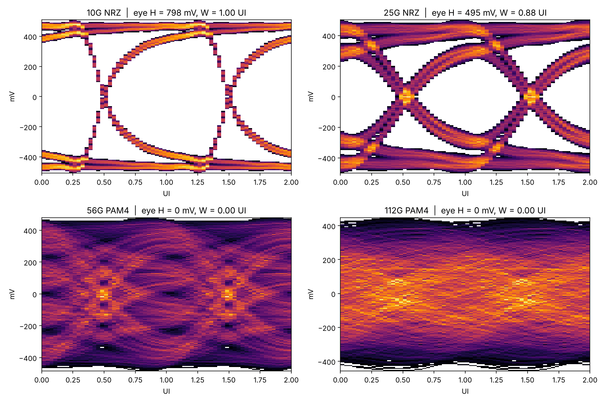
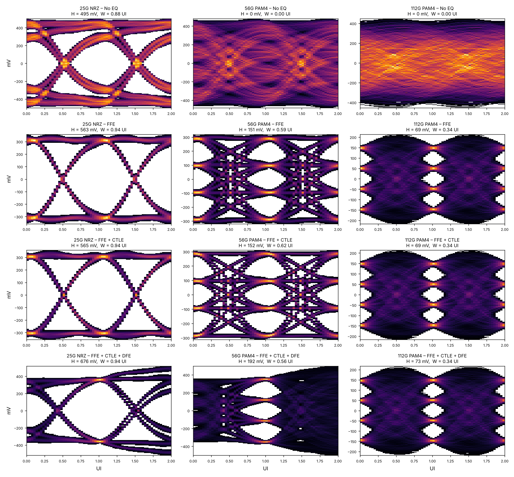
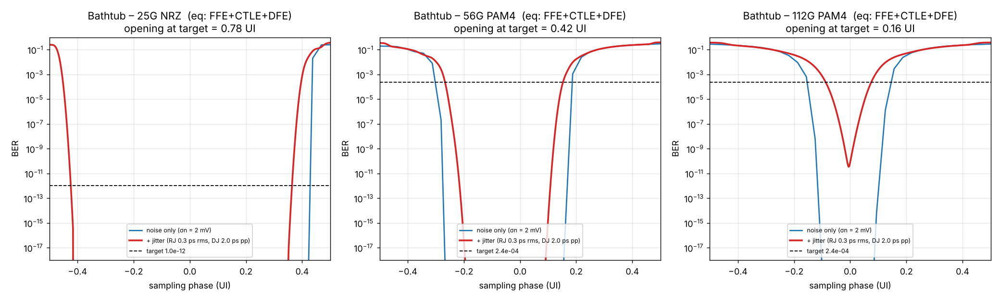
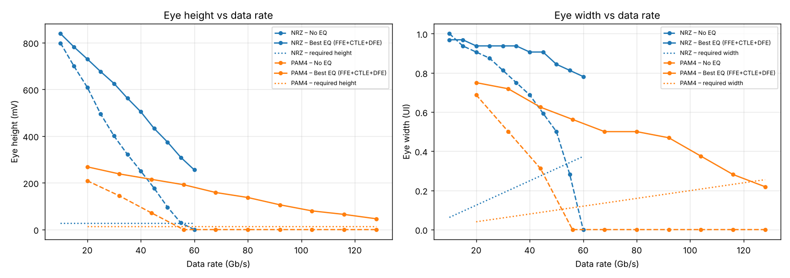
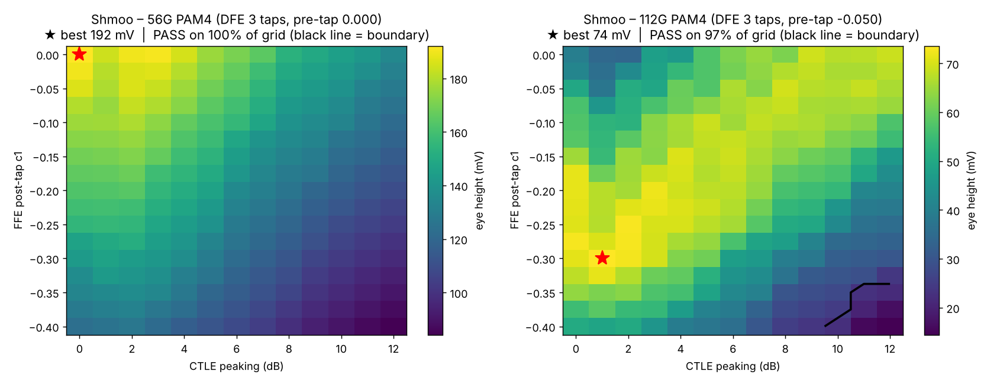
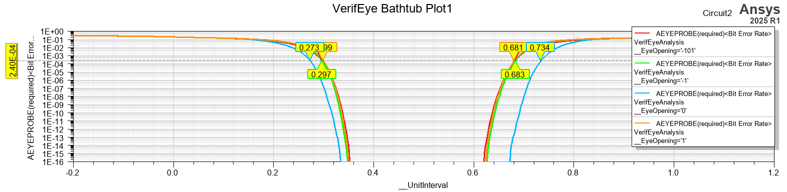
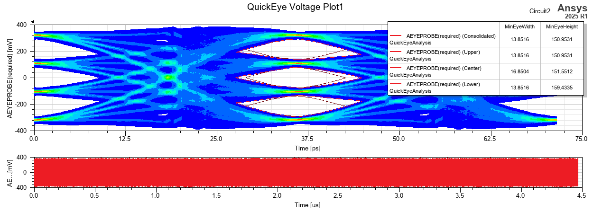
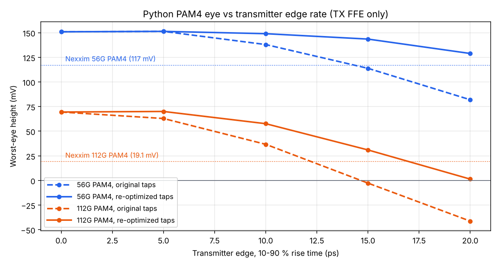

# High-Speed SerDes Channel Design & Link Analysis

End-to-end signal-integrity project: a **100 Ω differential PCB channel** designed in **Altium Designer**,
extracted in **Ansys SIwave** (0–40 GHz S-parameters), and analysed with a **Python SerDes link simulator**
(pulse response, NRZ/PAM4 eyes, FFE/CTLE/DFE equalization, jitter/noise BER and margin sweeps),
then **validated against Ansys Nexxim** (Quick Eye and VerifEye).

**Author:** R Dharma Teja, M.Tech Integrated Circuits & Microsystems Packaging, IIT Hyderabad
**Full report:** [High-Speed PCB Channel and SerDes Link Analysis — Final Report (PDF)](docs/High-Speed%20PCB%20Channel%20and%20SerDes%20Link%20Analysis%20%E2%80%94%20Final%20Report.pdf)
---

## 1. Channel design (Altium Designer → Ansys SIwave)

| Item | Value |
|---|---|
| Stack-up | 4-layer FR-4, 1.6 mm: Signal / GND / GND / Signal |
| Dielectric | 0.21 mm prepreg (Dk 4.4, Df 0.02), 1.065 mm core |
| Geometry | Differential microstrip, W = 0.246 mm, S = 0.203 mm (100 Ω target, Altium impedance profile) |
| Length | 150 mm, edge launches with 4 GND vias, GND stitching vias along the pair |
| Extraction | SIwave SYZ sweep, 0–40 GHz, 4001 points, causality & passivity enforced → `data/PCB3.s4p` (project: `siwave/PCB3.siw`) |
| Design files | Altium project in `altium/` (open `Diff_Pair.PrjPcb`), SIwave project in `siwave/` |

**Extracted channel:** differential impedance **101 Ω** (TDR), insertion loss **−2.8 dB @ 5 GHz,
−6.2 dB @ 12.5 GHz, −12.6 dB @ 28 GHz**, return loss better than −17 dB up to 12.5 GHz.

---

## 2. Pulse response & eye diagrams (`phase2_pulse_eye.py`)

S-parameters → differential SDD21 → impulse/pulse response → PRBS-15 waveform → eye diagram.

| Case | IL @ Nyquist | Post-cursor h1 | Eye (no EQ) |
|---|---|---|---|
| 10G NRZ | −2.8 dB | 10 % | 798 mV / 1.0 UI |
| 25G NRZ | −6.2 dB | 21 % | 495 mV / 0.88 UI |
| 56G PAM4 | −6.7 dB | 21 % | closed |
| 112G PAM4 | −12.6 dB | 36 % | closed |



---

## 3. Equalization (`phase3_equalization.py`)

* **TX FFE:** 3 taps (pre/main/post), peak-swing constrained, grid-optimised
* **RX CTLE:** 1-zero / 2-pole, 0–15 dB peaking
* **RX DFE:** 3 taps (ideal decisions)

| Case | No EQ | FFE | FFE + CTLE + DFE |
|---|---|---|---|
| 25G NRZ | 495 mV | 563 mV | **676 mV / 0.94 UI** |
| 56G PAM4 | closed | 151 mV | **192 mV / 0.56 UI** |
| 112G PAM4 | closed | 69 mV | **73 mV / 0.34 UI** |



---

## 4. Noise, jitter & BER (`phase4_jitter_ber.py`)

Statistical BER from ISI samples + Gaussian RX noise (2 mV rms), RJ (0.3 ps rms) and dual-Dirac DJ (2 ps pk-pk).
Targets: NRZ 1e-12, PAM4 2.4e-4 (pre-FEC, KP4 RS-FEC).

| Case | Best BER (with jitter) | Timing opening at target | Result |
|---|---|---|---|
| 25G NRZ | < 1e-30 | 0.78 UI | PASS |
| 56G PAM4 | < 1e-30 | 0.42 UI | PASS |
| 112G PAM4 | 3.4e-11 | 0.16 UI (jitter-limited) | PASS |



---

## 5. Margin sweeps (`phase5_margin_sweep.py`)

* **Data-rate sweep:** NRZ passes to 60 Gb/s with EQ; **PAM4 passes to 116 Gb/s, fails at 128 Gb/s** (eye width).
* **Shmoo (CTLE peaking × FFE post-tap, DFE on):** 112G PAM4 passes on 97 % of the grid, best at CTLE 1 dB / c1 = −0.30.
  Over-equalization (high CTLE + strong FFE) is the only failing corner.




---

## 6. Validation in Ansys Nexxim (AEDT 2025 R1)

The same channel (`data/PCB3.s4p`) was rebuilt as a Nexxim circuit: `EYESOURCE_DIFF` → PCB3 N-port → `EYEPROBE_DIFF`
with 50 Ω terminations. **Quick Eye** gives eye height/width, **VerifEye** gives BER bathtubs with jitter
(0.3 ps rms RJ, 1 ps periodic jitter in place of the 2 ps dual-Dirac DJ). TX FFE, RX DFE and RX CTLE were all cross-checked.

| Check | Python | Nexxim | Agreement |
|---|---|---|---|
| Insertion loss @ 12.5 / 28 GHz | −6.2 / −12.6 dB | −6.18 / −12.68 dB | within 0.6 % |
| 25G NRZ eye, no EQ | 495 mV | 496 mV | within 0.2 % |
| 56G / 112G PAM4, no EQ | closed | closed | match |
| 25G NRZ timing margin @ 1e-12 (FFE) | 0.81 UI | ≈ 0.77 UI | within 5 % |
| 56G PAM4 timing margin @ 2.4e-4 (best FFE) | 0.39 UI | 0.38 UI | within 3 % |
| 112G PAM4 timing margin @ 2.4e-4 | 0.16 UI | 0.14–0.15 UI | within 10 % |
| 56G PAM4 eye, best FFE / best FFE + DFE | 151 / 192 mV | 117 / 151 mV | same trend, ≈ −22 % |
| CTLE over-equalization @ 12 dB (56G) | h1/h0 = −0.189 | DFE tap 1 = −0.180 | match |
| DFE and CTLE at 112G | add almost nothing | add almost nothing | match |

**Two-way FFE tap check.** Each tool's taps were run in both tools. At 56G each tool's own taps work best in that tool
(Python puts all correction on the post-cursor; Nexxim also uses a pre-cursor tap). At 112G Python's taps are better in both.

**Why the tools differ with equalization.** Python converts the S-parameters with an inverse FFT and ideal edges;
Nexxim fits them with a rational state-space model (order 768). The two treat the band edge (32–40 GHz and above)
differently, and FFE boosts exactly those frequencies. `phase6_edge_rate_study.py` tests this: slowing the Python TX edge
reproduces Nexxim's trend, and the best 112G pre-cursor tap moves from −0.05 to −0.175 (Nexxim chose −0.154).

**112G VerifEye note.** The per-eye curves for the outer PAM4 eyes stayed flat at about 2e-1, while the combined curve opened.
Removing all jitter and moving the decision thresholds (±95 → ±70 mV) did not change the outer curves but did change
the combined one, so the combined curve is taken as the 112G result.





All Nexxim screenshots are in `results/nexxim/`.

---

## How to run

```bash
pip install -r requirements.txt
python phase2_pulse_eye.py       # pulse response + eyes
python phase3_equalization.py    # FFE / CTLE / DFE
python phase4_jitter_ber.py      # bathtubs + noise sweep
python phase5_margin_sweep.py    # data-rate sweep + shmoo
python phase6_edge_rate_study.py # edge-rate study (Nexxim comparison)
```

Plots are written to `results/python/`. Noise/jitter assumptions are set at the top of `phase4_jitter_ber.py`.

## Repository structure

```
├── data/PCB3.s4p                SIwave-extracted 4-port S-parameters (0–40 GHz)
├── phase2_pulse_eye.py          pulse response, cursors, eye diagrams
├── phase3_equalization.py       TX FFE, RX CTLE, RX DFE
├── phase4_jitter_ber.py         noise, jitter, BER bathtubs
├── phase5_margin_sweep.py       data-rate sweep and shmoo
├── phase6_edge_rate_study.py    edge-rate study for the Nexxim comparison
├── results/python/              plots generated by the scripts
├── results/nexxim/              Ansys Nexxim screenshots
├── altium/                      Altium Designer project: schematic and PCB layout
├── siwave/PCB3.siw              Ansys SIwave project used for the extraction
├── nexxim/Project2.aedt         Ansys Nexxim (AEDT) circuit project
├── docs/                        full project report (PDF)
└── requirements.txt
```

## Limitations

* Ideal DFE in Python (no error propagation); no crosstalk, connector or package models; no TX noise.
* Noise/jitter values are representative assumptions, not taken from a specific standard.
* S-parameters end at 40 GHz, so the band edge is tapered; this is where Python and Nexxim differ most.
* Nexxim full-chain (CTLE/DFE) checks were run in Quick Eye, without jitter.
